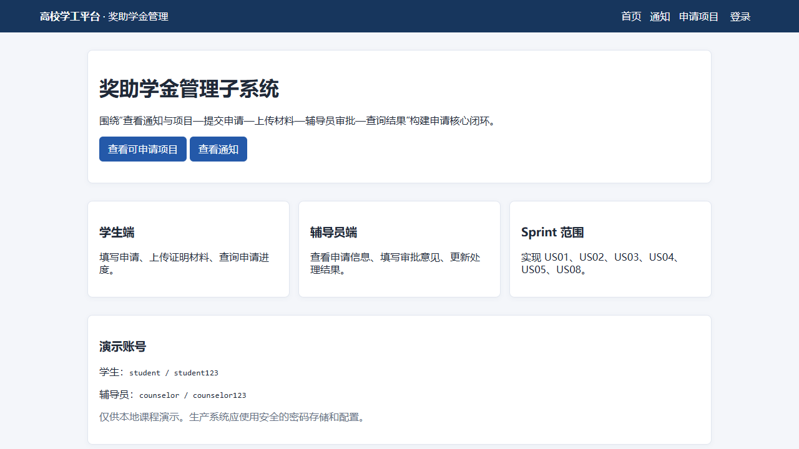

# 高校学工平台——奖助学金管理子系统（v1.0.0 · Sprint 1 发布版）

[](https://github.com/acekun486-tech/scholarship-sprint-planning/actions/workflows/quality.yml)
[](docs/test-report.md)
[](docs/quality/coverage-record.md)
[](docs/release-notes-v1.0.0.md)

本项目依据软件项目管理实验二的 Sprint Planning 实现，跑通“通知与项目查询—提交申请—上传材料—辅导员审批—学生查询结果”的核心闭环。实验三补充每日站会、配置管理与发布记录，实验四补充覆盖率、静态扫描、代码评审、缺陷响应与质量门禁。

> **发布基线**：`v1.0.0`（2026-11-16）。功能、质量数据与已知问题见 [v1.0.0 发布说明](docs/release-notes-v1.0.0.md)。

## 界面预览



GitHub 仓库页面只能展示源码和静态图片，不能直接执行 Flask、SQLite 或表单提交。若需要在浏览器中体验完整交互，需要把应用部署到支持 Python 的云平台；GitHub Pages 仅适合静态页面，无法替代本项目后端。

[](https://render.com/deploy?repo=https://github.com/acekun486-tech/scholarship-sprint-planning)

## Sprint 范围

| 用户故事 | 实现内容 | 页面或接口 |
|---|---|---|
| US01 | 查看奖助学金通知 | `/notices` |
| US02 | 查询项目、查看详情、条件和截止日期 | `/projects`、`/projects/<id>` |
| US03 | 填写并提交申请，服务端校验和重复提交防护 | `/apply/<project_id>` |
| US04 | 上传 PDF/PNG/JPG/JPEG，校验扩展名、文件签名和 5 MB 限制 | `/applications/<id>/upload` |
| US05 | 辅导员查看申请与材料、填写审批意见、更新状态 | `/counselor/applications` |
| US08 | 学生查看本人状态、意见和材料 | `/dashboard` |

US06（学院汇总上报）和 US07（名额管理与公示）不在当前 Sprint 内。

审批状态按以下规则流转：

```text
待审批 -> 通过
       -> 不通过
       -> 退回补充材料 -> 学生补传材料 -> 待审批
```

已通过或已不通过的申请不能再次审批，也不能继续上传材料。

## 技术栈与结构

- Python 3.10+
- Flask、Flask-WTF
- SQLite
- Jinja2、HTML/CSS
- pytest、pytest-cov

```text
app.py                应用工厂、路由、校验、权限和上传处理
database.py           表结构、种子数据、旧密码迁移和连接清理
templates/            页面模板
tests/test_app.py     业务、权限、上传与审批自动化测试
docs/                 Sprint Backlog、验收清单、站会、配置项、变更控制和质量记录
docs/quality/         覆盖率、静态扫描、代码评审、缺陷台账与质量报告
reports/lab4/         质量扫描与覆盖率的原始证据
.github/workflows/    CI 质量门禁
scripts/quality.ps1   本地一键质量检查
tools/                覆盖率函数级度量脚本
uploads/              本地材料存储目录
render.yaml           Render 在线部署配置
Procfile              通用 Python Web 启动配置
.devcontainer/        GitHub Codespaces 一键环境
```

## 本地运行

```powershell
python -m venv .venv
.\.venv\Scripts\Activate.ps1
pip install -r requirements.txt
$env:SECRET_KEY = "replace-with-a-long-random-value"
python app.py
```

打开 <http://127.0.0.1:5000>。

未设置 `SECRET_KEY` 时，应用会生成本次进程使用的临时密钥，重启后现有登录会话失效。课程演示也应设置稳定密钥。

首次启动会创建 `scholarship.db` 并写入演示数据。旧版本创建的明文演示密码会在初始化时自动升级为哈希密码。

## 在线展示

### GitHub Codespaces

1. 在仓库页面选择 `Code → Codespaces → Create codespace on main`。
2. 等待环境安装完成，在终端执行：

```bash
FLASK_HOST=0.0.0.0 python app.py
```

3. 在 `Ports` 面板打开 `5000` 端口，并把可见性设为 `Public`。
4. 使用生成的 `*.app.github.dev` 地址访问完整应用。

Codespaces 适合临时演示，停止或删除 Codespace 后地址即失效。

### Render

点击上方的 `Deploy to Render`，或按 [部署说明](docs/deployment.md) 手动创建 Web Service。生产启动命令为：

```text
gunicorn app:app --bind 0.0.0.0:$PORT
```

部署完成后，把 Render 提供的公开地址填入 GitHub 仓库右侧 `About → Website`，即可从仓库首页进入在线系统。

Render 默认文件系统是临时存储；如需保留申请和上传材料，需要挂载持久化磁盘并配置 `DATABASE_PATH`、`UPLOAD_FOLDER`。详细步骤见 [部署说明](docs/deployment.md)。

## 演示账号

| 角色 | 用户名 | 密码 |
|---|---|---|
| 学生 | `student` | `student123` |
| 辅导员 | `counselor` | `counselor123` |

演示密码只用于课程环境。用户密码在数据库中保存为 Werkzeug 哈希，不保存明文。

## 测试与质量

```powershell
.\.venv\Scripts\python.exe -m pytest -q --cov --cov-report=term-missing
.\scripts\quality.ps1
```

当前结果：**40 passed**，语句/分支/函数/行覆盖率 **100%**，Ruff 0 项，Bandit 0 Blocker/Critical，重复代码 0%，最大圈复杂度 9。CI 在每次 push 和 PR 时执行 Ruff、Bandit、覆盖率门槛（核心 ≥80%）与增量覆盖率检查（PR ≥60%）。

- [测试记录](docs/test-report.md)
- [覆盖率记录](docs/quality/coverage-record.md)
- [静态扫描记录](docs/quality/static-scan.md)
- [代码评审记录](docs/quality/code-review-record.md)
- [缺陷响应台账](docs/quality/defect-ledger.md)
- [一页质量报告](docs/quality/quality-report.md)

## 过程与配置管理

- [团队角色与协作约定](docs/team-roles.md)
- [每日站会记录](docs/standup-records.md)
- [配置项清单](docs/configuration-items.md)
- [变更控制记录](docs/change-control.md)
- [合并冲突演练记录](docs/git-conflict-exercise.md)
- [Sprint Backlog](docs/sprint-backlog.md)
- [验收检查清单](docs/acceptance-checklist.md)

## 安全与权限

- 表单启用 CSRF 防护，登录会话使用 HttpOnly、SameSite Cookie。
- 学生只能查看和下载本人申请材料；辅导员可查看审批所需材料。
- 申请提交同时执行重复检查和数据库唯一索引。
- 材料使用随机存储名，避免同名覆盖；下载时重新校验数据归属。
- 上传文件除扩展名外还校验 PDF、PNG、JPEG 文件签名。
- 服务端校验必填项、字段长度、审批意见、项目截止日期和状态流转。
- 响应增加 `nosniff`、同源 CSP、防嵌入等安全头。

## DoD 与课程边界

核心故事具备自动化测试、错误提示、角色权限、材料关联和运行文档。自动化质量门禁已通过；`docs/acceptance-checklist.md` 中的“团队第二成员代码评审”仍待评审人确认，因此质量报告结论为“有条件合并”。

本项目仍是课程原型：SQLite 和本地文件存储适合单机演示，未覆盖生产部署所需的对象存储、病毒扫描、审计日志、备份、邮件提醒、管理员名额维护和公示流程。演示账号的固定口令仅限课程环境使用。
